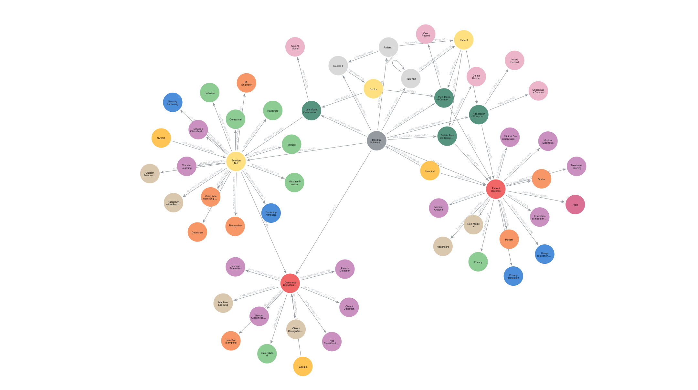

# Cypher Query Builder for Metadata Card Analysis

**Author:** Ali Mehraj  
**Organization:** Tampere University  
**Version:** 1.0

## Overview

This application supports knowledge-graph-based analysis of software metadata by generating Cypher queries for a Neo4j database. It is designed for scenarios where users need to explore relationships between software systems, AI models, data assets, components, users, and related risk or use metadata cards for analysis.

The system transforms an analysis request into a tailored Cypher query, searches the graph model to find the required paths between nodes, and executes the query against a Neo4j instance. The output is returned as structured JSON data that can be used for further analysis or integration into downstream tools.

## Key Functionalities

The application provides the following core capabilities:

- Generates Cypher queries dynamically from analysis requirements.
- Builds traversal paths across a predefined graph model of software and AI-related entities.
- Supports one or more conditions in a single request.
- Resolves relationships such as data risk, intended use, domain relevance, and access paths.
- Connects to a Neo4j database, executes the generated query, and returns the results in a readable JSON format.
- Enables analysis of metadata cards through a graph-based representation rather than static tables.

## Application Workflow

1. The application reads an analysis request from the request configuration.
2. The request is checked against the graph model: the analysis node, each target node, relationship and property must exist in it; anything unknown is refused with an error that lists the valid options.
3. The query builder determines the shortest valid traversal path from the analysis node to each target node.
4. The generated MATCH and WHERE clauses are assembled into a complete Cypher query. Target values are passed as query parameters, never written into the query text. Each condition's target node has its own variable, so two conditions can reach the same kind of node (for example two use types, one through the data and one through the model); a hop reached by the same route is shared, so conditions through the same dataset hold on the same dataset.
5. The query is executed against Neo4j using the configured database credentials. Each matching element is returned once (`RETURN DISTINCT`).
6. The returned records are transformed into plain JSON objects for easy inspection.

## Project Structure

- index.js — entry point of the application.
- queryBuilder.js — constructs the Cypher query from the supplied request.
- pathFinder.js — finds paths between node types in the graph model (graphModel.js).
- graphModel.js — defines the graph relationships and the properties of each node label used by the query builder. The graph model is the one of the metadata card knowledge graph project (a user's assigned user is `ASSIGNED_USER`; card nodes keep their display name in `name`), so the queries also run on graphs built by that project. That project's system links carry validity dates (`valid_from`, `valid_to`); this query builder does not filter on them.
- request.js — example analysis request used by the application.
- analysis_requirement_list.js — ten analysis requirements that combine several node types, each as text and as a request in the request.js format, with the expected answer on the sample graph. Run one with `npm start -- <number>`.
- tests/ — tests of the query builder (`npm test`).
- metadata_cards/ — sample metadata cards (one software system, one AI model, two datasets, four software components, three software users) for a hospital scenario. The system card names the system, its owner and the models, datasets, components and users it consists of.
- graph/seed.cypher — the sample knowledge graph, written by hand from the metadata cards: every node and relationship, with a comment naming the card field it comes from. Values that are a reading of the card rather than a value it names are marked INTERPRETATION.
- seed.js — loads graph/seed.cypher into the database configured in .env (`npm run seed`).

## Prerequisites

- Node.js
- A running Neo4j instance or Neo4j Aura deployment
- Access credentials for the target database

## Installation and Execution

Follow these steps from start to finish to run the application with Neo4j:

1. Install dependencies:
   npm install

2. Create a .env file in the project root and configure the Neo4j connection details:
   NEO4J_URI
   NEO4J_USERNAME
   NEO4J_PASSWORD

3. Load the sample graph into an empty Neo4j database:
   npm run seed

   This runs graph/seed.cypher in one transaction against the database in .env and prints how many nodes and relationships the database then holds. Running it again does not duplicate anything. Alternatively, paste graph/seed.cypher into the Query tab of Neo4j Aura or Neo4j Browser.

   The graph is written by hand from the cards in metadata_cards. The system card places everything in one system, "Hospital Software System". To build your own graph, edit graph/seed.cypher (or write your own) following the graph model in graphModel.js.

4. Define the analysis request in request.js according to the use case you want to test. A sample is already provided in the file. The request object should include:
   - analysisNode: the starting node for the query.
   - conditions: an array of one or more conditions.
   - Each condition should contain:
     - targetNode: the node you want to reach.
     - targetRelationship: the relationship that leads into targetNode at the end of the path (optional; without it the shortest path to targetNode is used). If the relationship does not lead into targetNode, the request is refused.
     - targetProperty: the property to compare (optional; by default the node's value property from the graph model, for example `domain_name` for Domain and `use_type` for Use_Type). It must be a property of targetNode.
     - targetValue: the value to match.


   Example structure:
   ```js
   const request = {
     analysisNode: "Software_System",
     conditions: [
       {
         targetNode: "Severity",
         targetRelationship: "DATA_RISK_SEVERITY",
         targetProperty: "severity",
         targetValue: "High"
       }
     ]
   };
   ```

   In this example, the application starts from the Software_System node, then looks for a path to the Severity node using the relationship DATA_RISK_SEVERITY. It then filters the result so that the severity property equals High. You can extend the conditions array with additional conditions if you want to combine multiple constraints in one query.

5. Start the application:
   npm start

   To run one of the prepared analysis requirements instead of request.js, give its number from analysis_requirement_list.js:
   npm start -- 3

The application will generate the Cypher query, print it with its parameters, connect to Neo4j, and print the results to the console.

To run the tests (no database needed):
   npm test

## Sample Graph

The sample graph after `npm run seed` (58 nodes, 71 relationships), as shown in Neo4j: the Hospital Software System
in the centre, with its components, users and roles (top right), the EmotionNet model (left), and the Patient Records
(right) and Open Images Extended MIAP (bottom) datasets, each with the values its card reports.



## Example Use Case

The application can be used to answer questions such as:

- Which software systems are associated with high-severity data risks?
- Which AI models are linked to a specific use type or domain?
- Which software components are connected to a given user role or access pattern?

To use the application for a specific analysis scenario, the user must define the corresponding use case in the request configuration file manually. At present, automated conversion from natural language to machine-interpretable requests is not supported.

Before running the application, load the sample graph with `npm run seed` if you want to test the provided example. You are free to define your own graph model and data instead; in that case, update the graph model in graphModel.js to match your graph model.


## License

This project is licensed under the MIT License. See the [LICENSE](LICENSE) file for more details.